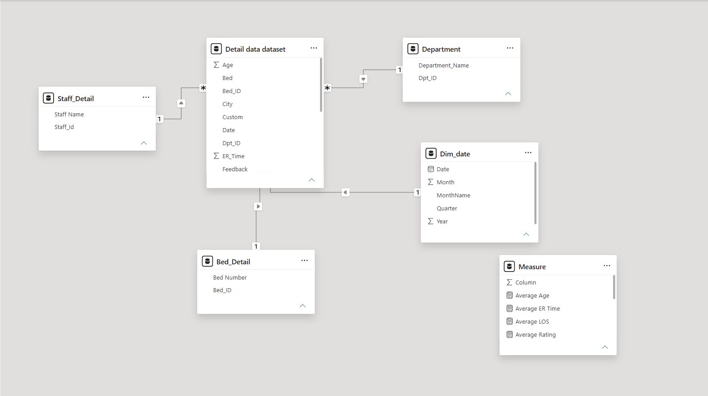
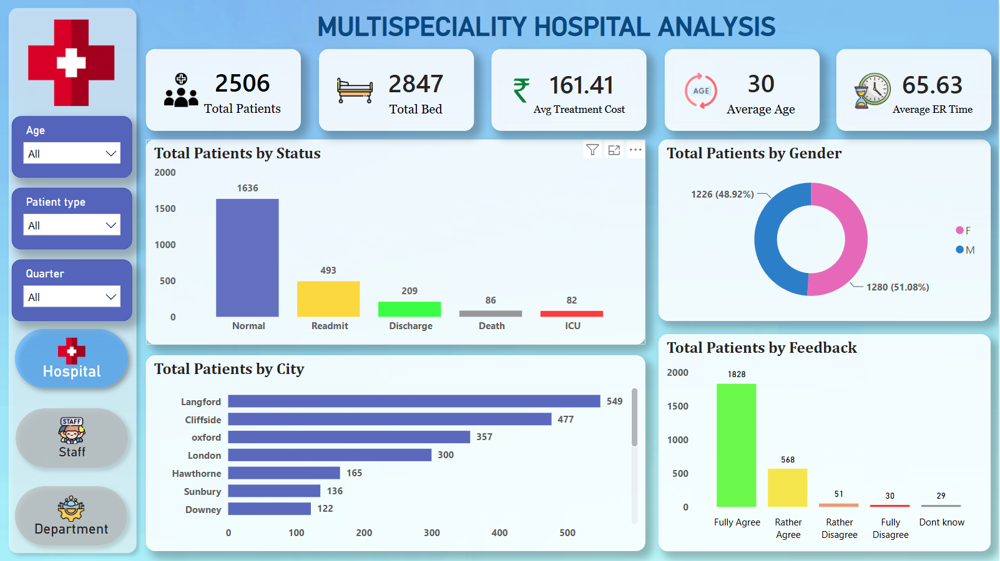
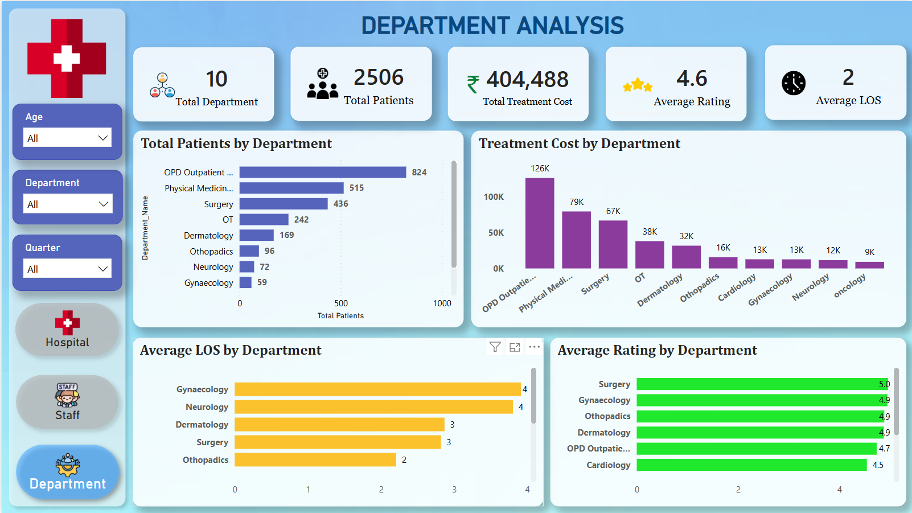
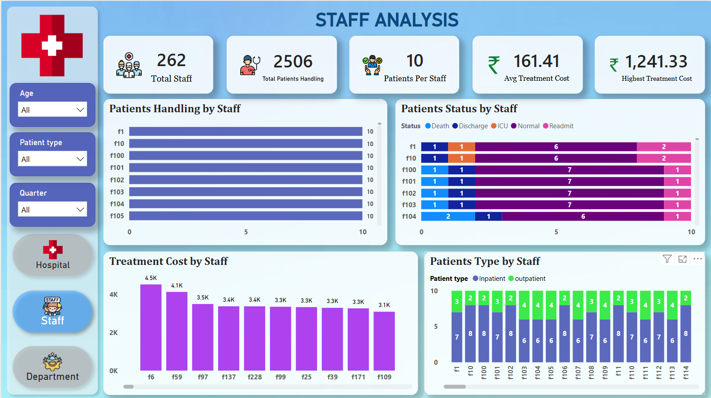

# 🏥 Multispeciality Hospital Operations & Patient Care Analytics

## 📌 Project Overview
An enterprise-grade healthcare analytics solution built using Microsoft Power BI to monitor hospital efficiency, departmental performance, staff workload distribution, and patient satisfaction across inpatient and outpatient services.

---

## 🏗️ Data Architecture & Star Schema
The semantic data model is designed around an optimized Star Schema:
* **Central Fact Table:** `Detail data dataset` capturing patient admissions, ER waiting times, treatment costs, bed allocations, and patient ratings.
* **Dimension Tables:** `Staff_Detail`, `Department`, `Bed_Detail`, and `Dim_date`.
* **Centralized Measures:** Dedicated `Measure` table housing all business logic and KPI calculations.



---

## 📊 Dashboard Views & Operational Insights

### 1. Multispeciality Hospital Overview
High-level operational summary tracking core hospital capacity metrics:
* **Capacity & Volume:** 2,506 total patients served across 2,847 hospital beds.
* **Cost & Timeliness:** Average Treatment Cost of ₹161.41 with an Average ER waiting time of 65.63 minutes.
* **Demographics & Status:** Gender split (51% Female vs. 49% Male), patient status distribution (Normal, Readmit, Discharge, ICU, Death), and regional patient flow (top volume from Langford, Cliffside, and Oxford).
* **Patient Experience:** Feedback breakdown showing a positive majority (1,828 Fully Agree responses).



### 2. Departmental Deep Dive
Evaluates revenue contribution, service quality, and efficiency across 10 specialized hospital departments:
* **Patient Traffic:** OPD leads volume with 824 patients, followed by Physical Medicine (515) and Surgery (436).
* **Financial Impact:** OPD Outpatient (₹126K) and Physical Medicine (₹79K) generate the highest total treatment cost.
* **Length of Stay (LOS) & Quality:** Gynaecology and Neurology average 4 days LOS, while Surgery achieves the highest patient satisfaction rating (5.0/5.0).



### 3. Staff Utilization & Patient Handling
Workforce workload monitoring and operational assignment analytics:
* **Staff Capacity:** 262 total staff members managing an average of 10 patients per staff member.
* **Cost Extremes:** Maximum individual treatment cost monitored up to ₹1,241.33.
* **Inpatient vs. Outpatient Allocation:** Tracking patient care outcomes (Readmit, Normal, ICU, Discharge, Death) and patient types by staff ID to prevent burnout and ensure balanced coverage.



---

## 🧮 Key DAX Calculations
A representative sample of business measures calculated in this project:

```dax
// Average Length of Stay (LOS)
Average LOS = AVERAGE('Detail data dataset'[LOS])

// Average Emergency Room Response Time (Minutes)
Average ER Time = AVERAGE('Detail data dataset'[ER_Time])

// Overall Patient Satisfaction Rating
Average Rating = AVERAGE('Detail data dataset'[Rating])

// Patients per Staff Member
Patients Per Staff = 
DIVIDE(
    DISTINCTCOUNT('Detail data dataset'[Patient_ID]), 
    DISTINCTCOUNT('Staff_Detail'[Staff_Id]), 
    0
)
```

## 🛠️ Tech Stack & Skills
* **BI Tool:** Microsoft Power BI Desktop
* **Data Modeling:** Star Schema Modeling, One-to-Many Relationships
* **Analytics & Calculations:** Advanced DAX (Time Intelligence, Aggregations, Ratios)
* **ETL & Data Transformation:** Power Query (M) for data cleansing and schema normalization
* **UI/UX Design:** Dark-themed clinical layout with custom icon-based bookmark navigation
